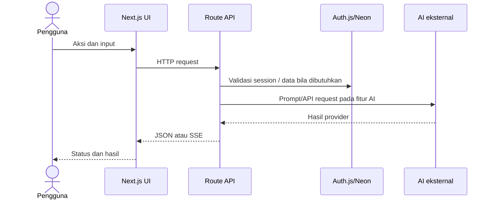
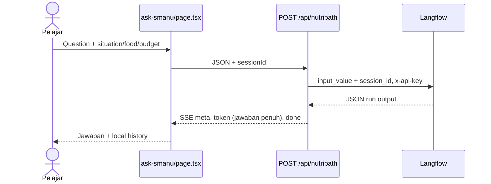
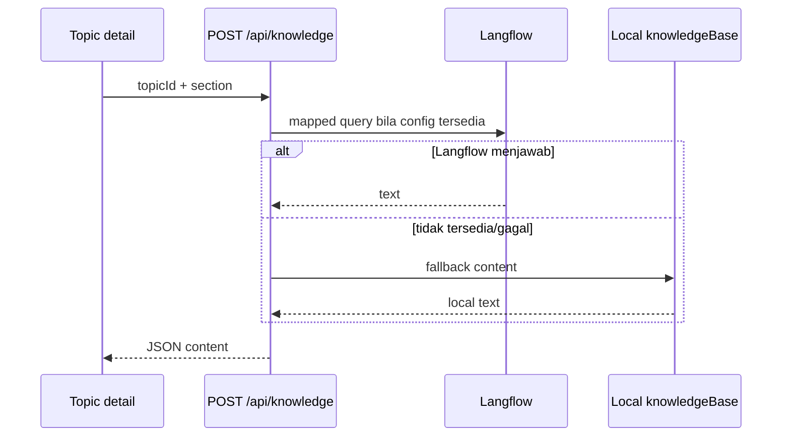
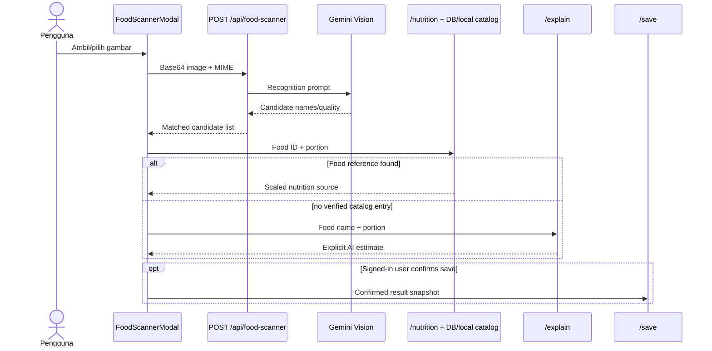

# Alur Data

**Pembaruan:** 2026-11-12

## Sistem



## Ask SMANU



Route juga memiliki path OpenAI/Gemini lokal retrieval ketika Langflow tidak terkonfigurasi. Ini bukan jaminan semua jalur aktif; lihat [AI_ARCHITECTURE.md](AI_ARCHITECTURE.md).

## Nutrition Knowledge



## Food Scanner



Recognition is not proof of ingredients/weight. Scan image is documented in route as memory-only; photo contribution endpoint currently stores consent metadata.

## Authentication

```mermaid
sequenceDiagram
  actor U as User
  participant UI as Login UI/SessionProvider
  participant A as Auth.js handler
  participant DB as Neon users
  U->>UI: Email/username + password
  UI->>A: Credentials callback
  A->>DB: Find user
  A->>A: bcrypt compare; JWT session
  A-->>UI: Cookie/session
  UI->>A: GET /api/auth/session
  A-->>UI: Session JSON or empty session
```

JWT and user fields source are defined in `auth.ts`; do not store/report password hashes or token values.
