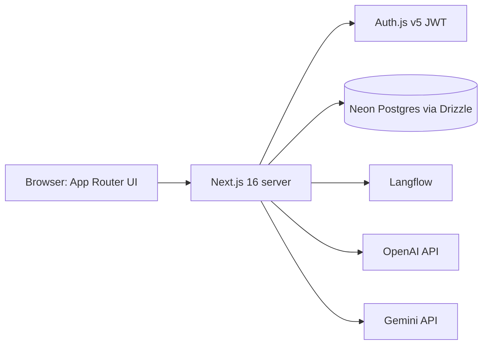

# Arsitektur Sistem

**Pembaruan:** 2026-11-12

## Ringkasan aktual

Satu aplikasi Next.js App Router pada root repository menyajikan UI React, route API server, auth, dan akses Neon. Integrasi model berjalan dari route server-side; API key tidak dimaksudkan dikirim browser. Provider eksternal dianggap PARTIALLY VERIFIED sampai smoke test runtime.

## Batas runtime

- UI utama: `app/(main)/`; autentikasi: `app/(auth)/`.
- Handler server: `app/api/**/route.ts`. Middleware hanya memeriksa halaman `/login` dan `/register`; bukan middleware proteksi umum.
- Neon adapter berada di `lib/db/index.ts`; URL dibaca server-side dari `DATABASE_URL`.
- `/api/nutripath` menjalankan Langflow jika konfigurasi Langflow lengkap. Tanpa Langflow config, OpenAI dicoba sebelum Gemini. Jika Langflow config ada namun panggilan gagal, route merespons error alih-alih beralih ke provider lain.
- `/api/ai-chat` adalah Gemini multi-turn terpisah.

## Yang belum dapat dipastikan

Aktivasi provider, status flow Langflow Cloud, deployment Vercel, data aktual production, dan konfigurasi runtime tidak dibuktikan oleh file konfigurasi saja. Lihat [INTEGRATIONS.md](INTEGRATIONS.md) dan [PROJECT_STATUS.md](../PROJECT_STATUS.md).
