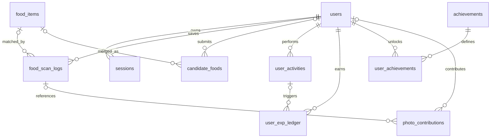

# Tabel dan Relasi

**Pembaruan:** 2026-11-12 
Skema di bawah dibaca dari `lib/db/schema.ts` dan migrations, bukan introspeksi database saat audit.

| Tabel | PK/unique utama | FK dan catatan |
|---|---|---|
| `users` | `id`; unique `username`, `email` | Root user table; `password_hash` wajib, role default student. |
| `sessions` | `session_token` | `user_id → users.id`, cascade. |
| `verification_tokens` | Kolom `identifier`, `token`, `expires`; tidak terlihat constraint unik pada schema saat ini | Tidak punya FK. |
| `food_items` | `id`; unique `food_id` | Referensi makanan dengan nama alias, kategori, nilai nutrisi, sumber, verified/isEstimate. |
| `food_scan_logs` | `id` | `user_id → users.id` cascade; `recognized_food_id → food_items.id` set null. Menyimpan snapshot hasil; bukan foto asli. |
| `candidate_foods` | `id` | `user_id` opsional set null; `merged_food_id → food_items.id` set null; migration unique pending pada normalized name. |
| `user_activities` | `id`; unique `(user_id, idempotency_key)` di migration 0003 | `user_id → users.id` cascade. Type, source ref, score/domain, verified. |
| `user_exp_ledger` | `id`; unique `(user_id, idempotency_key)` di migration 0003 | User cascade; `activity_ref → user_activities.id` set null. |
| `achievements` | `id`; unique `key` | Definition, reward, category, sort order. |
| `user_achievements` | `id`; unique `idempotency_key` | User dan key achievement FK cascade. |
| `photo_contributions` | `id` | User dan scan FK nullable/set null. Metadata consent/status; storage ref opsional. |

Constraint yang sesungguhnya terpasang perlu dicek pada database environment terkait. Migration 0006 menambah `verified` pada activity dan EXP dengan default false, sehingga record lama tidak otomatis eligible.
