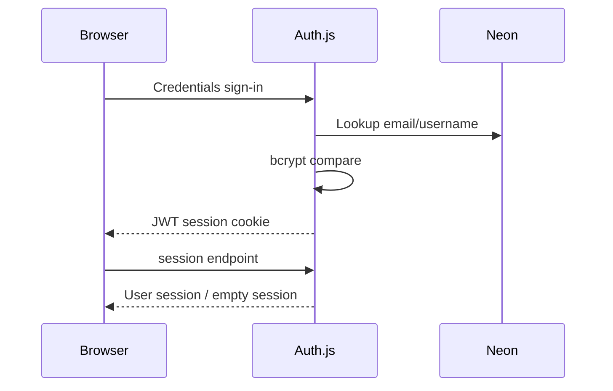

# Authentication

**Pembaruan:** 2026-11-12 
**Status:** PARTIALLY VERIFIED

## 1. Purpose

Mendaftarkan akun, mengautentikasi credentials, dan menyediakan sesi bagi route yang memerlukan user.

## 2. Current Implementation

Auth.js v5 (`next-auth` beta) dengan Credentials provider, JWT strategy, pencarian email/username pada `users`, dan pembandingan password memakai `bcryptjs`. Session callback menambahkan `id`, `username`, dan `fullName`. Login/register UI berada di route group `(auth)`.

## 3. Directory and Files

- `auth.ts` — konfigurasi provider, callback, cookie, dan ekspor handler/auth/signIn/signOut.
- `app/api/auth/[...nextauth]/route.ts` — ekspor GET/POST handlers.
- `app/api/auth/register/route.ts` — validasi, uniqueness, hash bcrypt, insert.
- `middleware.ts` — redirect user yang sudah masuk dari `/login` atau `/register`; route lain dilewatkan.
- `context/AuthContext.tsx`, `app/layout.tsx` — client session wrapper.

## 4. Architecture

## 5. Data Flow

Registration menerima nama, username, email, password dan konfirmasi; password minimum 8 karakter dan hash bcrypt dengan 12 rounds. Auth lookup menggunakan normalized identifier. Hash tidak dikirim balik ke client.

## 6. API Endpoints

- `/api/auth/[...nextauth]` GET/POST.
- `/api/auth/register` POST.
- Protected API menggunakan `auth()` dan `session.user.id`.

## 7. Database Dependencies

`users` adalah sumber akun. Schema juga mendeklarasikan tabel Auth.js adapter/session, meski strategi sesi aktif pada `auth.ts` adalah JWT.

## 8. External Dependencies

`next-auth`, `@auth/drizzle-adapter` (tercantum manifest), Neon, Drizzle, bcryptjs.

## 9. Current Status

Source handler dan register flow ditemukan. Login runtime, cookie pada production, database reachability, serta environment Vercel belum diperiksa pada audit dokumen ini.

## 10. Known Bugs

- `auth.ts` mengandalkan konfigurasi secret Auth.js dari runtime; `middleware.ts` fallback ke `AUTH_SECRET` lalu `NEXTAUTH_SECRET` dan string kosong. Pastikan variabel konsisten pada semua environment.
- Middleware hanya matcher halaman login/register; jangan anggap semua halaman terlindungi.

## 11. Limitations

Credentials saja; tidak ada OAuth/email verification yang ditemukan. Middleware tidak melakukan query DB.

## 12. Pending Improvements

Tambah smoke/regression test `/api/auth/csrf`, `/api/auth/session`, credentials, guest, dan environment production tanpa mencetak credential.

## 13. Testing

Tidak ada test script pada `package.json`; live Auth endpoints tidak diuji ulang dalam dokumentasi audit.

## 14. Related Tasks

Lihat [NEXT_TASK.md](../project-management/NEXT_TASK.md) dan daftar environment di [ENVIRONMENT_VARIABLES.md](../engineering/ENVIRONMENT_VARIABLES.md).

## 15. Security review berbasis source (2026-11-12)

- Credentials provider membandingkan bcrypt hash di server dan mengembalikan hanya data identitas ke JWT/session; strategy aktif JWT. Tabel Auth.js `sessions` dideklarasikan, tetapi tidak dipakai oleh strategy ini.
- Middleware hanya redirect pada `/login` dan `/register`; route API dan data authorization harus terus memanggil `auth()` dan memeriksa ownership/role sendiri.
- `middleware.ts` memakai `AUTH_SECRET ?? NEXTAUTH_SECRET ?? ""`, sedangkan Auth.js memakai resolusi secret default. Samakan sumber secret dan pastikan deployment fail closed bila secret tidak ada; jangan menambah fallback kosong atau secret hardcoded.
- Register memvalidasi field dan memakai bcrypt 12 rounds, tetapi memulangkan pesan conflict berbeda untuk email dan username; rate-limit login/register belum terlihat pada source yang diperiksa.
- Nama `AUTH_SECRET` lokal terdeteksi pada audit sebelumnya; value tidak dibaca. Environment Vercel belum diperiksa dan tidak boleh disimpulkan dari lokal.
- Belum ada bukti source/test untuk brute-force controls, recovery/password-reset, verification, session revocation, session expiration policy, atau account deletion. Tandai sebagai NOT IMPLEMENTED/UNKNOWN sampai diverifikasi, bukan diasumsikan tersedia.
- Regression acceptance: guest session, login valid/invalid, csrf/session response, cookie pada HTTPS preview, secret missing fail-closed, throttling, role/admin denial, dan data isolation. Jangan menjalankan terhadap akun atau production tanpa izin.
