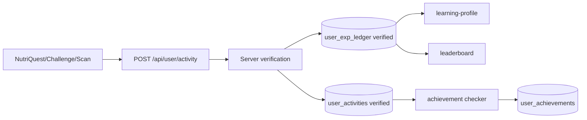

# Student Nutrition League

**Pembaruan:** 2026-11-12 
**Status:** PARTIALLY VERIFIED

## 1. Purpose

Menyajikan EXP, level, tier, leaderboard, achievement, dan histori EXP dari aktivitas belajar tersimpan.

## 2. Current Implementation

`POST /api/user/activity` mewajibkan auth dan memvalidasi NutriQuest/Food Challenge dari bank/skoring server atau memastikan scan milik user. Event dan ledger verified menggunakan idempotency key. Profile, League UI, dan leaderboard hanya membaca event/EXP verified.

## 3. Directory and Files

- `app/(main)/league/page.tsx`, `app/(main)/learning-journey/page.tsx`
- `components/league/*`, `components/dashboard/StudentNutritionLeagueWidget.tsx`
- `app/api/user/activity/route.ts`, `app/api/user/learning-profile/route.ts`
- `app/api/league/leaderboard/route.ts`, `achievements/route.ts`, `check-achievements/route.ts`
- `lib/exp-system.ts`, `lib/achievement-checker.ts`
- `lib/db/migrations/0003_learning_profile.sql`, `0006_league.sql`

## 4. Architecture

Aktivitas divalidasi dengan source ref; server menghitung skor/EXP dan menyimpan ledger append-only. EXP level/tier dihitung pada waktu query. Achievement disimpan dengan key idempoten.

## 5. Data Flow

## 6. API Endpoints

`POST /api/user/activity`, `GET /api/user/learning-profile`, `GET /api/league/leaderboard?window=...`, `GET /api/league/achievements`, `POST /api/league/check-achievements`.

## 7. Database Dependencies

`user_activities`, `user_exp_ledger`, `achievements`, `user_achievements`, `users`, serta `food_scan_logs`. Migration 0006 menambah `verified` yang default false dan tabel achievement.

## 8. External Dependencies

Neon Postgres. Activity check di server menggunakan question bank dan challenge data lokal.

## 9. Current Status

Sumber kode memuat verified events dan idempotensi. Catatan sesi sebelumnya melaporkan 0006 dijalankan dan tabel/17 definisi diverifikasi; audit dokumentasi tidak mengecek production DB ulang. Akun user dan race tests belum diuji.

## 10. Known Bugs

Tidak ada temuan runtime baru pada audit dokumentasi. Hindari menganggap source migration saja sebagai bukti environment tertentu.

## 11. Limitations

Aktivitas lama/default unverified tidak dihitung sebagai progress. Hasil browser lokal bukan sumber leaderboard. Public leaderboard tidak mengirim user ID entry.

## 12. Pending Improvements

Automate tests for duplicate request, concurrent duplicate, score tampering, foreign scan ID, missing migration, and account/guest UI states.

## 13. Testing

Catatan sesi sebelumnya: build terisolasi, lint, endpoint smoke pascamigrasi lulus; test akun/race tidak dilakukan. Lihat handoff.

## 14. Related Tasks

[Next task](../project-management/NEXT_TASK.md), [schema](../database/TABLES_AND_RELATIONS.md), [migration history](../database/MIGRATIONS.md).
